# Quansheng UV-K5 for the 23cm (1297MHz) band
https://www.cqham.ru/forum/showthread.php/46386-Quansheng-uv-k5-%D0%BD%D0%B0-%D0%B4%D0%B8%D0%B0%D0%BF%D0%B0%D0%B7%D0%BE%D0%BD-23cm-1297-MHz

Accessed using proxy, as [CQHam.ru now restricts access to Russian IP blocks](https://ra1ahq.blog/en/nedostupen-prosmotr-forumov-cqham-ru)

Translated using Google Translate web on 2026 Oct. 6th

# LZ3HD Development Sequence
* v1: Q_MOD_1297_MHz_MOD_XX.jpg, Screenshot_2025-01-18_205930.jpg
* v2: V2_MOD_L2.png, V1_MOD_L1b.png, https://www.youtube.com/watch?v=j2hYy455Tak
* v2.1: V2_MOD_L3a.png, V2_MOD_L3b.png
* v2.2: DSC_3310_MOD_3.png
* v2.3: V3_MOD_L3a.png, V3_MOD_L4b_m.png

The last images seem cumulative, i.e. you shouldn't need to do all the changes in V2_MOD_L3a then all the changes in DSC_3310_MOD3 then all the changes in V3_MOD_L3a, you should just be able to do all the changes in V3_MOD_L3a.
Also V3_MOD_L4b_m is unfortunately a low-res version, but fortunately it's the same as V2_MOD_L3b

## Rework Steps from youtube

This is definitely not all the modifications from a fresh radio to v2, so maybe this is just the differences from v1? or from XENOMORPH's original mod?

* (backside) Remove transistor
* Remove capacitor
* Remove 2nd capacitor?
* Remove air-core inductor
* Remove capacitor
* Remove ?
* (backside) Remove L1
* (backside) Replace L1

# Full Forum Archive

## XENOMORPH
09.12.2023, 15:07

Modifying the Quansheng UV-K5 (prototype) for the 23cm band (1260–1300 MHz).

I didn't need the other bands, so I disabled them in the firmware and removed any obstructing components from the PCB.

The firmware has been modified to provide the maximum RF chip output power for this band.
The `firmware_1260-1300` version uses standard modulation with low and high frequencies cut off; deviation is around 20 kHz (sounds louder and punchier than any Baofeng).
The `firmware_1260-1300 ExtMOD` version (my own custom build) features improved modulation with enhanced low and high frequencies and a deviation of around 20 kHz; additionally, the receive audio bandwidth has been increased to 5.5 kHz.

To enter firmware update mode: hold down the PTT button while turning on the power using the volume knob.

Use the `k5prog_win_v1.26` programming software. After flashing, perform a settings reset (Menu Item 049: enter the menu by long-pressing the M button).

Using the Hex Workshop editor on the calibration file (read via `k5prog_win_v1.26`), you can customize the three power levels (LOW: 50 mW, MID: 500 mW, HI: 1 W) and the deviation level.
If necessary, the deviation level can be set to a value between 0 and 3800 (default is 1450–1500); the maximum deviation can reach up to 3 MHz!
You can change the deviation level by opening the firmware file in Hex Workshop and adjusting the values ​​as shown in the screenshots. Before changing the deviation, access the register settings.
Hold down button 5, then press PTT and the M button; use the M button to navigate to the DEV parameter, activate transmit mode, use the up/down arrows to select the desired value, note it down, and edit it in the firmware file as described above.

Retuning procedure:
Unscrew the circuit board. To tune the receiver, feed a signal from a signal generator into the antenna input; adjust the length and board-proximity of the inductors to achieve a sensitivity ranging from ~50µV (unmodified) to 0.16µV.
To tune the transmitter, connect a spectrum analyzer (with an external attenuator) or a power meter to the RF connector. Adjust the inductor lengths (by compressing or stretching them) and capacitor values ​​to achieve an output of 1000mW at the "HI" menu power setting.
The three power levels can be adjusted in the configuration file as described above (launch the k5prog_win_v1.26 software, turn on the radio, connect via the appropriate COM port, click "Read Calibration," save the file, and then edit the power values—specifically the transistor quiescent current—if necessary).
Inductors (loops) made from silver-plated cable strands.
After modification, the sensitivity is -122dBm and the maximum power is 30dBm (with precise tuning).
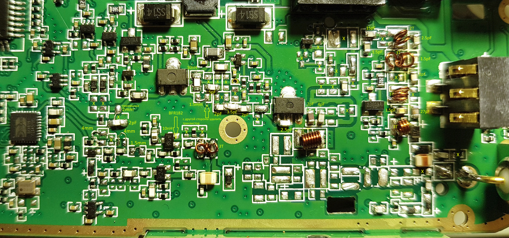

## XENOMORPH
12.12.2023, 20:27

New firmware; minor issues fixed.

## Соловей
13.12.2023, 06:34

What kind of antenna do you have? Is it homemade, or did you buy it?

## er1ak
13.12.2023, 09:06

So, our folks have shown up—shout-out to "Razboynik" and "Chernomor." I’m already on my third radio; the chip itself costs more than the whole unit. I treat it like a piece of test equipment—that’s my perspective. Thanks for starting this thread; here’s the link:
`https://github.com/spm81/Quansheng_UV-K5/blob/main/Firmware/UNIVERSAL%20FIRMWARE%20(%20All%20Radios%20-%20UV-K5%2C%20UV-K5(8)%2C%20UV-K6%2C%20UV-5R%20Plus%2C%20etc...)/Open%20Spectrum%20Firmware%20by%20facgi/uv-k5-firmware-fagci-mod-v1.1.2-SSB-lite-test.bin`
Oh, I forgot to mention: it lets you switch between FM and AM modulation.

## XENOMORPH
13.12.2023, 12:01

Solovey, it’s a homebrew J-pole antenna.
Colleagues, please don't spam the thread—otherwise, it’ll turn into a Telegram-style mess with thousands of messages going in circles about changing the backlight or the Satcom coil.
This thread is strictly for the 23cm conversion. If you have something new to propose regarding it, start a new thread and we can chat there.

## DerBear
15.12.2023, 13:50

Could you please advise...
I’ve seen that the radio can be unlocked for SSB reception. Obviously, it won't work for SSB transmission, but I’m toying with a budget-friendly idea for CW operation on 432/1300 MHz and/or for contests. 
The question is: does SSB work across the entire frequency range—from 18 MHz all the way up to 1300 MHz—or are there caveats? 
If SSB is available on 1300 MHz, is it possible to implement a 1 kHz transmit offset via software? 
And then, of course, I'd connect an external keyer to the PTT port...

Also, I read somewhere that the firmware source code is available. If anyone has it, could I take a look (maybe via PM)? 

Last edited by DerBear; 15.12.2023 at 13:59.

## XENOMORPH
15.12.2023, 14:01

This firmware includes wide-bandwidth pseudo-SSB; the offset can be set to practically any value in the menu. 
Here is the link to the source code; you can achieve narrow bandwidth by modifying the register values. 
https://github.com/fagci/uv-k5-firmware-fagci-mod

Last edited by XENOMORPH; 15.12.2023 at 14:20.

## DerBear
15.12.2023, 14:20

So, what about SSB across the entire 18–1300 MHz range? 
I checked GitHub; they have ready-made firmware binaries posted there. Is there actual source code that gets modified and compiled, or is the whole process based on reverse-engineering the factory binary—tweaking registers according to the datasheet? 

Last edited by DerBear; 15.12.2023 at 14:28.

## XENOMORPH
15.12.2023, 14:28

AM/FM/SSB/RAW/BYP modes are available across the entire range (15–1338 MHz). You can work with the source code in Keil, though if you're a "level 80" programmer, you could even do it in Notepad. 
If you know the binary's layout, it's much faster to tweak it directly when needed—that’s why I use this super-fast method; time is money these days.
Instructions on how and with what to compile are available here: https://github.com/OneOfEleven/uv-k5-firmware-custom

Last edited by XENOMORPH; 15.12.2023 at 14:56.

## DerBear
15.12.2023, 15:21

One more thing: did you create the mod for the 1300 by eye (relying on your experience with repairs and mods, etc.), or is there a schematic for the radio somewhere?

Update: found the schematic.

## XENOMORPH
15.12.2023, 16:16

You do the initial setup by eye, then fine-tune it using instruments. The circuit is as primitive as a crystal radio (at least to me).
However, for HF operation, you can't just solder in the specified components and immediately start transmitting; every drop of solder or a capacitance variance of even 0.2 pF has a significant effect.

## Serg
19.12.2023, 01:02

> So, is SSB available across the entire 18–1300 range?

It actually uses DSB for both transmit and receive; there is no true SSB capability.
You could try generating CW by feeding a 750–1000 Hz audio tone into the microphone input, but that’s really just child's play.

## er1ak
19.12.2023, 09:11

There is already firmware that supports CW reception and transmission—even with RIT—and keying via a push-button.

## Serg
19.12.2023, 12:18

Oh, really? Which firmwares have the telegraph feature?

## DerBear
19.12.2023, 12:18

> There is already firmware that supports CW reception and transmission—even with RIT—and keying via a push-button.

Could you give more details—where and how?
How are the timing relationships handled? I bought a radio recently; the first thing I did was flash the firmware and check the RX-TX switching times. With the Spektrum-compatible firmware, the switching time is very long. Any initial hopes for using it for telegraphy were quickly dashed.

## er1ak
19.12.2023, 12:29

Here’s the link: https://www.youtube.com/watch?v=wmyx26LthVQ. He promised to post the firmware, but it’s unclear which button he’s pressing since he filmed in the dark; I also found a design for a 23cm J-antenna. And here is the firmware: https://www.universirius.com/preppers/quansheng-uv-k5-manuale-del-firmware-ijv/ .

## DL8RCB
19.12.2023, 12:49

> I found a design for a 23 cm J-antenna.

Then you need to post it in the relevant thread.

## Serg
19.12.2023, 12:57

er1ak, you could have put it more briefly: check out the firmware from IJV.

##  er1ak
19.12.2023, 13:27

I could make it shorter; I’ll post the antenna once I’ve assembled it. Sorry if anything’s not quite right.

## DerBear
19.12.2023, 19:57

A wiring diagram for the switch has popped up on Facebook. They say it’s from the mod's creator.

There’s also a video showing a guy operating using the PTT button, but it didn’t attach here; I posted the video in the Telegram group. It shows receiving a beacon from 350 km away in USB mode.
They also managed to rig up SSB transmission somehow.

## er1ak
20.12.2023, 08:59

It looks like in the video I shared, he was indeed transmitting via PTT, and the IJV firmware doesn't have a waterfall display—which is a downside.

## Sergei12
25.02.2024, 15:59

http://www.hamskey.com/2024/01/introducing-uv-k5-version-01p-cw.html?m=1
Author of the firmware CW-KD8CEC

## EW6D
23.05.2024, 14:30

Good afternoon, everyone! Today I set about modifying one of my two "Kvasha" units for 1296 MHz, following the method described here. First, I flashed it with the updated firmware from the second post. By the way, which of the firmware versions did the OP improve? There are two different ones in the archive. After flashing, I wanted to try enabling transmission. Surely there would be *some* output level even without retuning the circuits—at least from the chip itself? Instead, it displays "DISABLE" when transmitting at any frequency between 1260 and 1300 MHz and emits an annoying beep. Is that how it's supposed to behave until I retune the output stages? In theory, it shouldn't be monitoring the transmitter output...

## XENOMORPH
23.05.2024, 14:45

A transmission lockout from the old firmware likely remains.
Turn on the power while holding down both the PTT button and the button below it. In the menu (accessed by a long press of the M button), select "TX ALL ENABLED," and set "TX" to "ON" for the other items.
The latest firmware is firmware_LAST_bin.rar.

## EW6D
23.05.2024, 16:22

Thank you so much!! Everything is working now!! Now I’m going to tackle the most painstaking part of the work...

## EW6D
28.05.2024, 20:40

Hi everyone! Today I gathered all the necessary tools—even a field strength meter—and decided to try modifying and resoldering the Quansheng board, following the method shared by the original poster. However, I ran into a problem: the board uses lead-free soldering technology, meaning the solder has a very high melting point. I tried desoldering just one capacitor; I heated it from all sides for five minutes, and while I finally managed to get it off, one of the traces actually lifted off the board. I soldered it back in place and decided this task was beyond my capabilities. In my line of work, I often have to repair devices assembled with high-melting-point, lead-free solder (damn the stuff...). The only solution is to crank up the soldering iron tip temperature and use plenty of flux—though flux burns off faster at higher temperatures. I use a soldering station... but experience shows that the board itself starts to scorch and warp. And considering the largest SMD component is size 0603, I didn't want to risk it; I'm afraid I'll ruin the board. Could you share how you managed to desolder so many components? Rose's metal might help, but not for such tiny solder joints. I’m amazed—how do people manage to solder in those AliExpress modules to replace the FM receiver chip? Are there perhaps Quansheng boards out there that were soldered using standard technology and regular solder? 

Last edited by EW6D; 28.05.2024 at 20:50.

## uk8adi
29.05.2024, 09:28

> Rose's alloy would help, but not for such tiny solder joints.

Why not? Well, if not a rose, then something else could be added!

## XENOMORPH
29.05.2024, 11:40

I did 95% of the soldering using a standard hot air gun from a soldering station.
I used a 5mm nozzle and the correct temperature setting. In some spots, I used a soldering iron (with a sharp, genuine, multi-layer tip).
You do need experience, I agree—you have to avoid burning the button substrate or melting the display plastic, although I actually desoldered the display completely.

Practice on "guinea pigs"—other, scrap circuit boards.

## R1AIT
29.05.2024, 12:35

Kapton tape comes in handy here, too—use it to mask off the areas you want to preserve. Rose's metal can present some surprises; it tends not to mix with the other solder and instead spreads across surfaces, which can eventually cause components to detach when subjected to even mild heat.

## er1ak
29.05.2024, 17:51

You're absolutely right about practicing on other boards; there’s also the paste used for reballing processors. I work with a hot-air gun fitted with a fine nozzle and heat the area with the soldering iron from both sides, alternating between them. Actually, I have a modification job ahead of me too; there’s a video on modifying a Satcom unit that’s worth checking out for reference. Anyway, regarding the 23cm J-pole antenna: I used GPS antenna cables for my experiments—though I bought them quite a while ago—and housed the assembly in a piece of electrical cable sleeving, sealing the bottom with hot glue.

## UA3IDQ
05.07.2024, 10:55

EW6D, how can I get in touch? Please send me a private message.

## LZ3HD
31.12.2024, 22:37

Hello,
While I wait for the QUANSHENG radio I ordered from AliExpress, I’ve been looking at the instructions for modifying it for the 23cm band and have a question for the author. Regarding the removal of the first (bipolar) transistor in the TX amplifier stage: what was the reason for replacing it with a jumper?
Thanks.

## XENOMORPH
31.12.2024, 23:38

LZ3HD, the transistor stage was removed as unnecessary because the power output was increased within the BK4819 chip itself.

## LZ3HD
31.12.2024, 23:47

Thank you, it’s a very interesting topic.
Happy New Year!

## Vl1962
15.01.2025, 03:44

Hello! I have a Quansheng UV-K5 (running the "Quansheng UV-K5 Spectrum mod" by @fagci, version 0.8).
I can't figure out why the volume and speech clarity are good in FM broadcast mode (F+0 mode), yet speech intelligibility is terrible when manually tuning to those same FM stations (i.e., not using F+0 mode), even though the signal strength indicator shows a strong signal. Could anyone let me know if this is normal behavior? I’m posting in this thread because it seemed like the most suitable place for this question.

## Serg
15.01.2025, 14:24

Vl1962, strictly speaking, these questions are off-topic for this thread—wasn't there a general thread somewhere about the "Kvashnya"?
But I'll give a brief answer: in F+0 mode, a dedicated WFM broadcast receiver is active.
However, when you simply tune to the frequency in standard mode, you are trying to listen to broadcast transmissions using a receiver designed for NFM (narrowband for voice communication).

## Vl1962
15.01.2025, 15:38

Thanks for the reply, but I tried setting the bandwidth to 25 kHz, 12.5 kHz, and 6.3 kHz (the firmware allows this). The result is the same—there is no intelligibility (I tried listening to speech, not music). Is the sensitivity in standard mode really that much lower than that of the built-in broadcast receiver? Has anyone tried this on their Quansheng radios?

## R1AIT
15.01.2025, 16:03

It’s not a matter of sensitivity. In FM broadcasting, the deviation is 75 kHz—meaning a 150 kHz bandwidth. If I recall correctly.

## Serg
15.01.2025, 16:09

Vl1962, that is exactly how it works—it’s not a defect, but simply a feature: the main receiver allows for the reception of these frequencies, though their reception isn't guaranteed.
Use the broadcast receiver mode; it even includes a dual-watch option, meaning the music cuts out when a signal appears on the communications frequency—which is very convenient.

## Vl1962
15.01.2025, 18:13

Tell me, is there firmware that allows enabling a bandwidth greater than 25 kHz, or is the limitation hard-coded in the hardware?

## R1AIT
16.01.2025, 08:07

It makes sense to ask in the relevant threads. For example, here: https://t.me/uv_k5

## LZ3HD
16.01.2025, 23:36

Hello,
The receiver started working immediately after the fix described in the instructions above.

https://www.youtube.com/embed/Ye9xJEmMejQ?wmode=opaque

The transmitter didn't want to work on the first attempt, but the chip is generating the correct frequency and level.

https://www.youtube.com/embed/ZSbevODmSqc?wmode=opaque

The special operation continues...

## uk8adi
17.01.2025, 11:00

Vl1962
You have already received an answer:

> But to give a brief answer: in F+0 mode, a dedicated WFM broadcast receiver is active.
However, when you tune to a frequency in standard mode, you are attempting to listen to broadcasts using a receiver designed for NFM (narrowband for voice communication).

And this, yes—

> The limitation is implemented in hardware.

...since the "heart" of the radio—the main transceiver chip—was designed for use in narrowband FM walkie-talkies, just like the previous 1846 chip.

## R4ABT
18.01.2025, 14:57

LZ3HD, please post a high-resolution photo of the modified board; I’ve put my modification project on hold—it’s just sitting there waiting...
If you can't upload it directly to the forum, please provide a link.

## LZ3HD
18.01.2025, 22:43

Since I couldn't get the transmitter running, I had to ask my friend LZ5HP for help. After a few hours of struggling with it, we managed to get an output of 0.8–1.2 W, though there are still some nuances that require further work. At this stage, the board looks pretty messy and isn't exactly "photogenic." I’ll take photos once everything is finished.
There is also a capacitor listed here that slightly improves receiver sensitivity (it should be replaced with a 1.5pF one or removed).

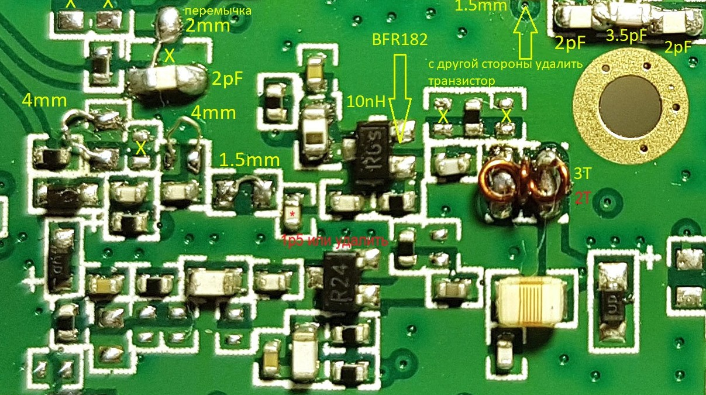
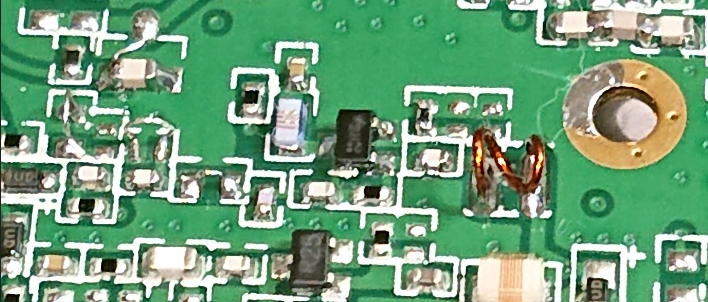

## LZ3HD
08.02.2025, 23:42

Hello,
I did not carry out the work described below alone. LZ5HP (Khristiyan) participated in this project and provided significant help in getting things moving in the right direction.
I would like to extend special thanks to the author of this thread for the design and for sharing it with the community.

We ended up with a slightly different hardware modification: receiver filtering for mobile networks was improved, and—consequently—the transmitter features a different transistor matching network, a different output filter, and a modified RX/TX switching circuit. These changes resulted in higher output power and the elimination of harmonics. The transmitter output is 1.48 W at 8 V, and the receiver squelch triggers at -122 to -123 dBm. Measurements were performed using a tinySA ULTRA with an external 40 dB attenuator.

Download: https://disk.yandex.ru/i/P4bgQ2KHIiCpgQ

To increase the output power (beyond 1 W), the gate voltage of the driver transistor must be raised; however, the drain current must not exceed 400–450 mA (the transistor's maximum current is 0.5 A). This procedure is risky, as the current could spike suddenly and destroy the transistor. In the photo, this is the '60k' resistor; I installed a 150k resistor in parallel with the existing 100k one. The resulting drain current was 460 mA at an 8.4 V supply voltage. There is no need to replace the BAR64 diodes and the BFR360 transistor; the original components are suitable.

Download: https://disk.yandex.ru/i/ktvO4MdAWnDtRg

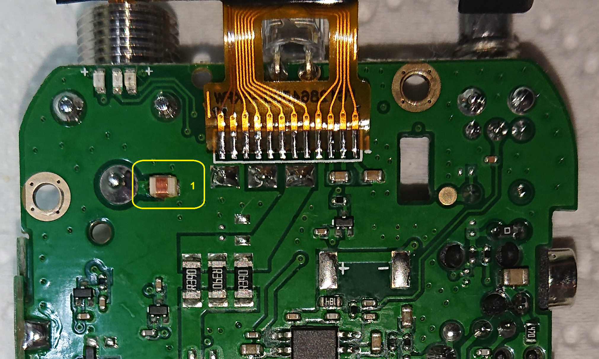
Download: https://disk.yandex.ru/i/L7BpV5_XfteahA

Desolder coil '1' and install coil '2' in its place (see below).

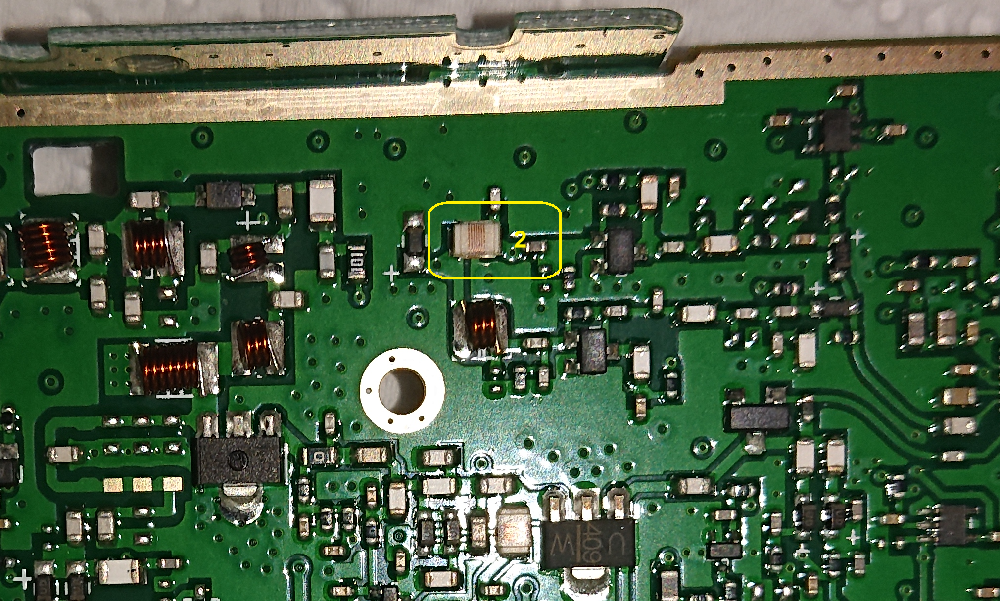
Download: https://disk.yandex.ru/i/fqr8DJ0itcgsuQ

---

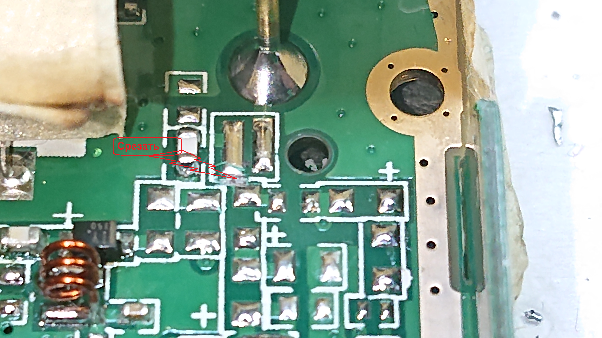
Download: https://disk.yandex.ru/i/6iZYFPjwkdL4Zg

Here, the bus needs to be cut to implement the new RX-TX switching scheme.

---

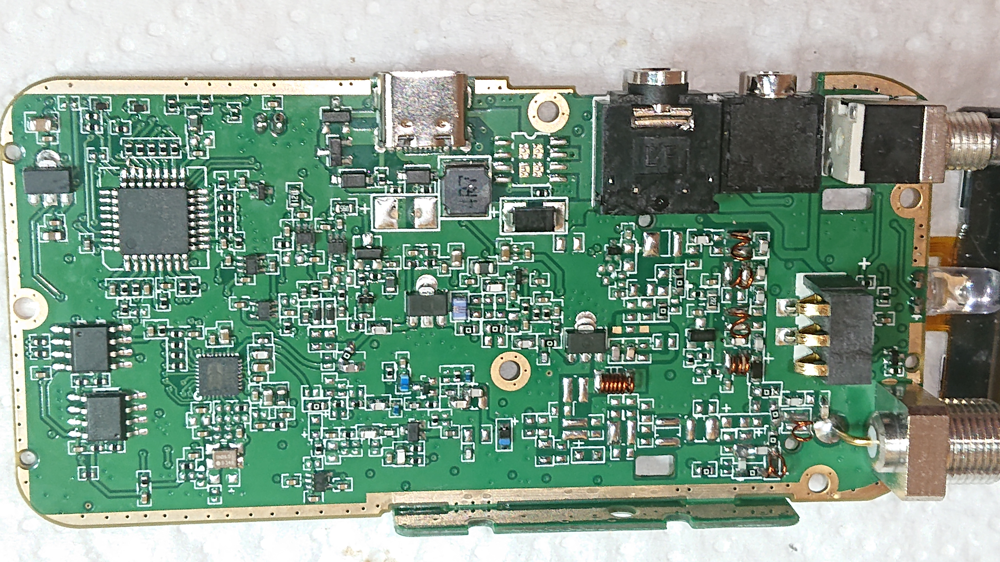
Download: https://disk.yandex.ru/i/qeNZW0Erw-wItg

Finished product, top view.

---

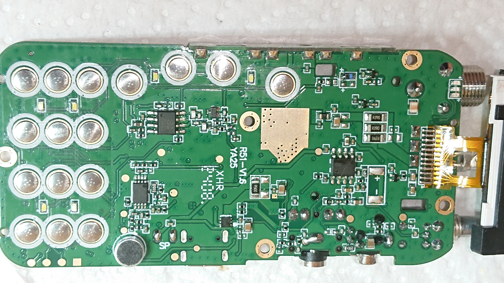
Download: https://disk.yandex.ru/i/QnRQFZ2q1UmSQw

Finished product: bottom view.

---

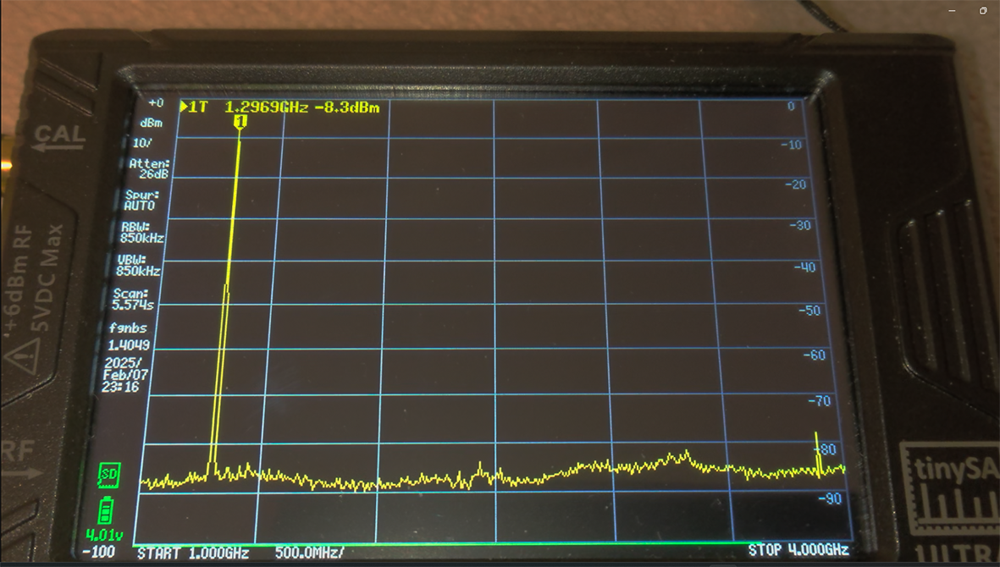
Download: https://disk.yandex.ru/i/tVAPloum_6-tuw

Output power: 31.7 dBm (-8.3 dBm + 40 dB attenuator), 8 V. No harmonics are observed in the 1 GHz to 4 GHz range.

---

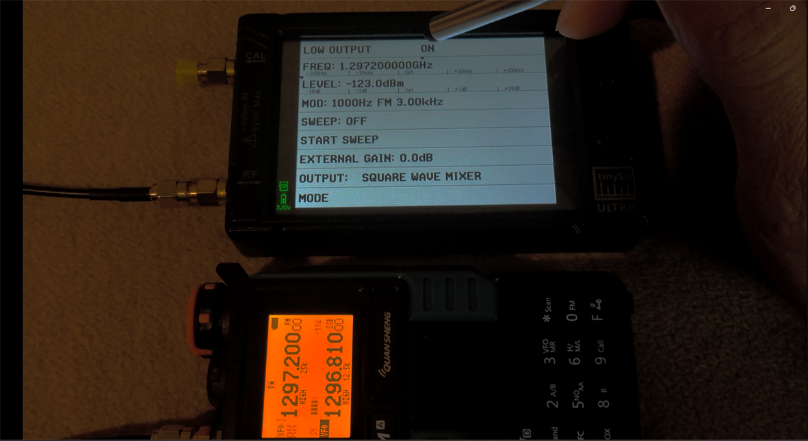
Download: https://disk.yandex.ru/i/mHP0_Je9HAGmuQ

The squelch opens at -122 to -123 dBm.

---

https://www.youtube.com/embed/j2hYy455Tak?wmode=opaque

## LZ3HD
14.02.2025, 19:00

Making the process waste-free:
(1/4 λ also performed well)

https://www.youtube.com/embed/yfuiPOJQCbE?wmode=opaque

## RA4FHE
25.02.2025, 18:27

> We ended up with a slightly different iron processing method, featuring improved filtration.

Please let me know the inner diameter of the LPF coils and the wire diameter.

## LZ3HD
25.02.2025, 19:06

If you are referring to the transmitter's output filter, you simply desolder the factory coil, unwind the excess turns, strip off the enamel, and solder it back in place (inner diameter 1.5 mm, wire gauge 0.36 mm).

## RA4FHE
25.02.2025, 19:20

Thanks, I'll give it a try.

## LZ3HD
12.05.2025, 14:53

Hello,
Since the first QUANSHENG was modified, we’ve gone through quite a bit of solder and taken the next step: building a repeater. Khristiyan (LZ5HP) built and tuned the filters and amplifiers (LNA and PA), while Vladimir (LZ1ZB) wrote the software for the control board.
Initial testing revealed that the QUANSHENG lacked sufficient dynamic range; to resolve this, we had to install a bandpass filter between the duplexer and the external LNA—starting with a two-stage filter and later upgrading to a three-stage one. We now have an output power of approximately 12W and a sensitivity of -122 dBm (0.17 µV). Measurements were performed using a TinySA Ultra and two 30 dB attenuators.

https://www.youtube.com/embed/_GHSqaMAtc0?wmode=opaque

When it comes to harmonics, everything is perfectly in tune:

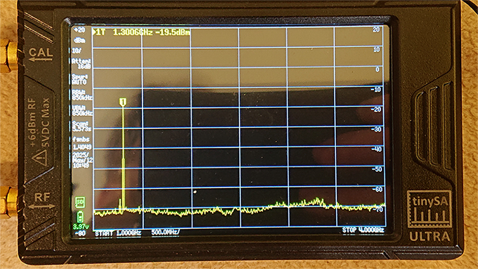

---

Repeater:

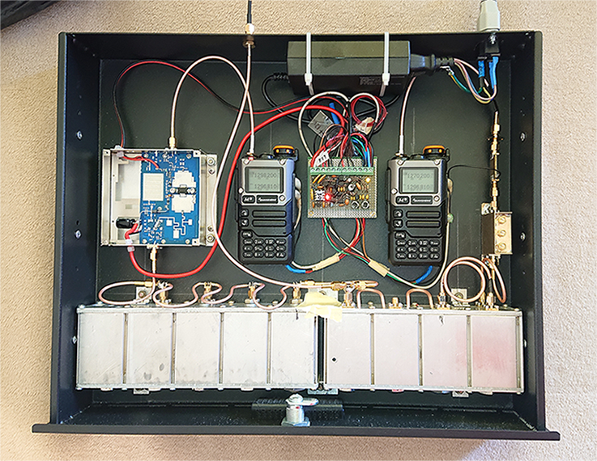

---

Filters (+LNA):

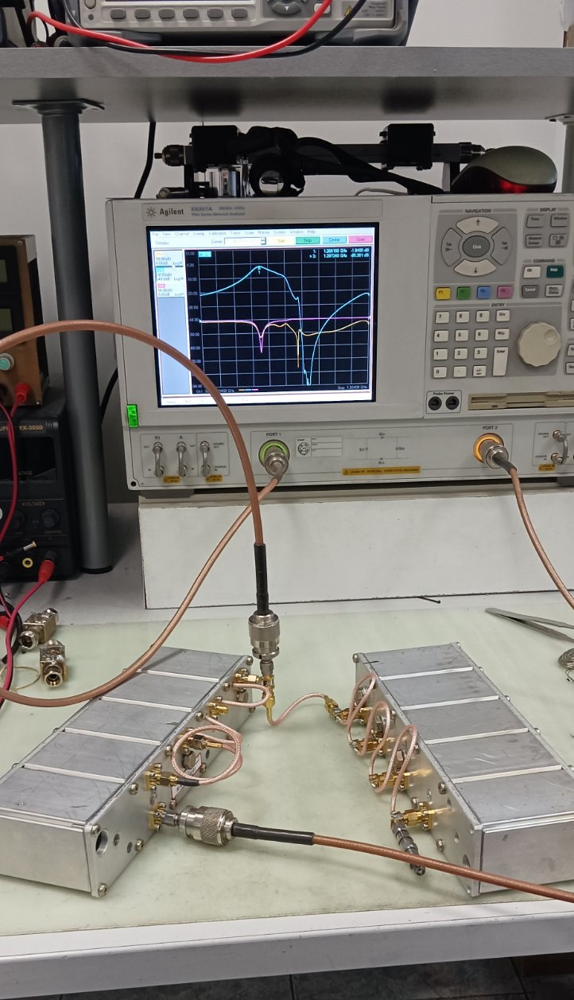
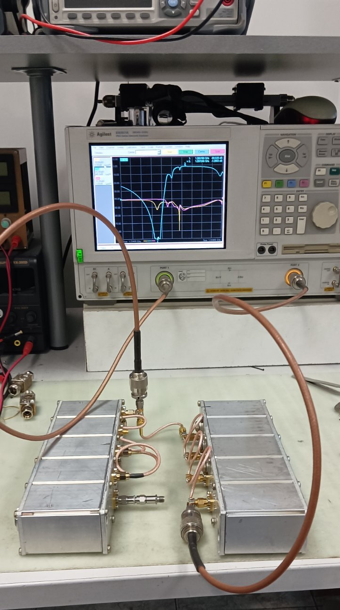
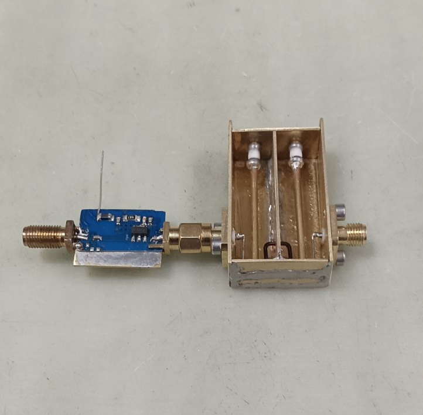
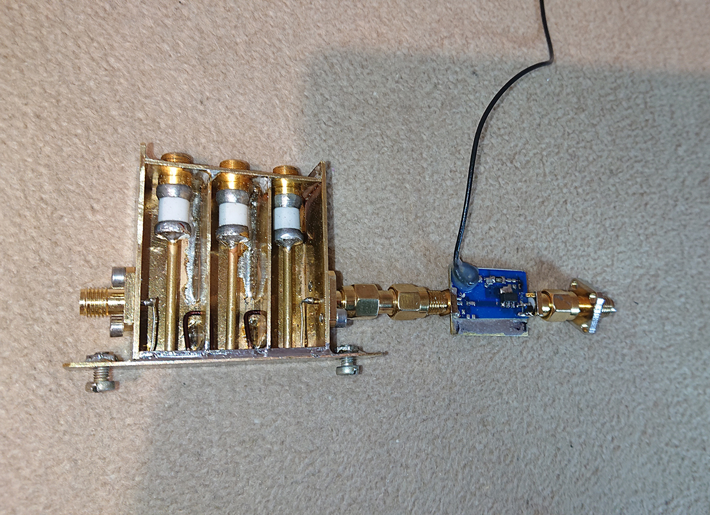
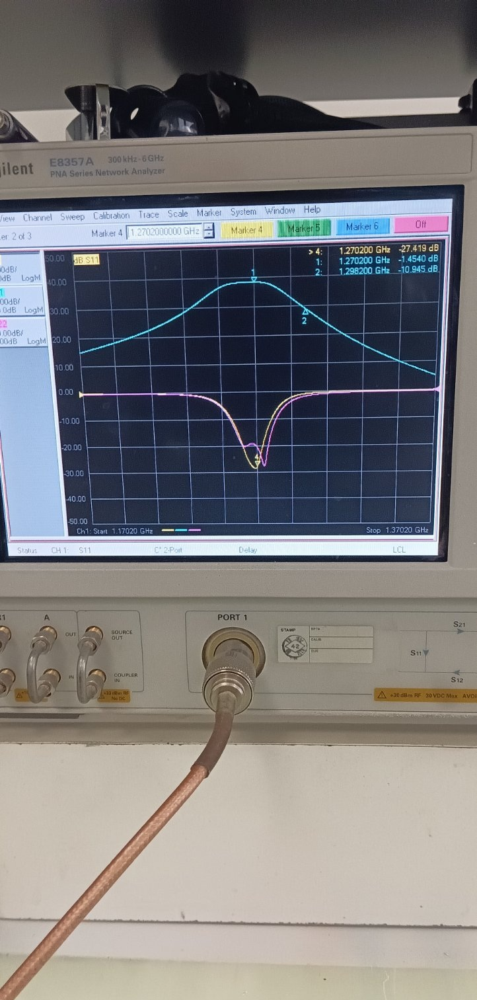

---

Amplifier:

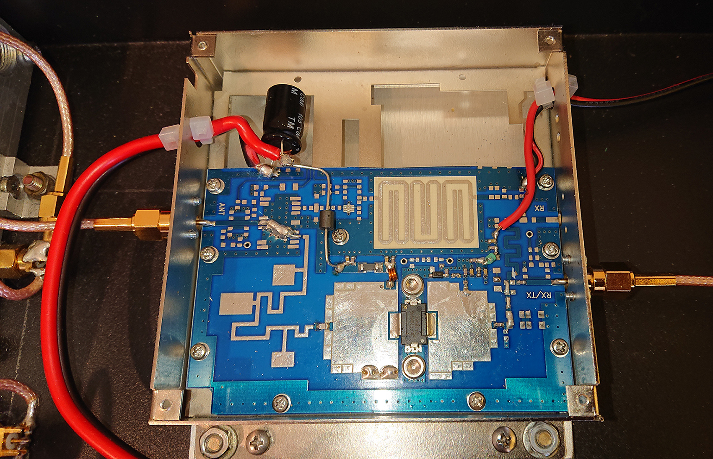

---

P.S. Regarding the QUANSHENG modification: you can improve sensitivity to -124 dBm and increase the power output to... (I won't specify the exact figure, as it depends on the batch, the PCB, and the phase of the moon), but it is worth doing:
(Changes are marked in red)

Download: https://disk.yandex.ru/i/sBwYRXI5F_P_SQ

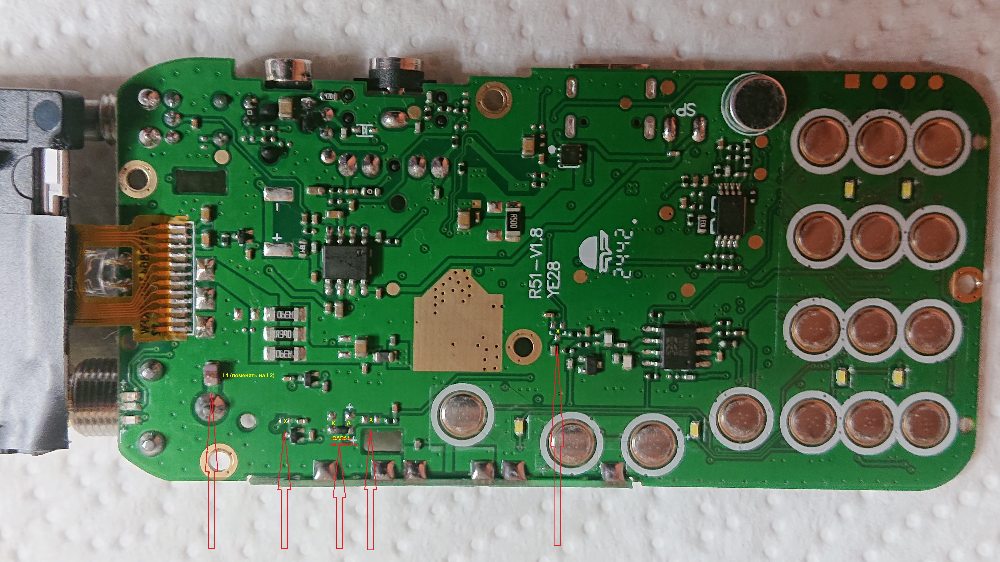
Download: https://disk.yandex.ru/i/FLBCueQgTu6U3w

Last edited by LZ3HD; 12.05.2025 at 15:17.

## LZ3HD
12.05.2025, 16:21

Please don't judge the build quality too harshly; this repeater was assembled as an experimental unit using defective and test-grade circuit boards and components. The duplexer is a repurposed band-pass filter from an NMT-450 system.

## er1ak
13.05.2025, 09:29

LZ3HD, thank you for the setup and the video—lots of useful information. Where can I order the 23cm amplifier board from you? 73!

## LZ3HD
13.05.2025, 12:42

I have sent you a private message.

## DL8RCB
13.05.2025, 15:59

> built a relay station

Good afternoon, I have a question for you: is it already in the works?

## LZ3HD
13.05.2025, 18:48 

Right now, a few of us are actively testing it at my place on the 9th floor. We still need to attach a fan to cool the power amplifier, although it doesn't really need it all that much. We’re going to build a weatherproof antenna, and there are plans to install the unit on the roof of a 22-story building.

## DL8RCB
13.05.2025, 22:30

> there are plans

Got it, thanks!
73

## LZ3HD
22.09.2025, 10:22

Hello,
I came across this information while browsing the internet:
(You can use Yandex Browser to translate the video)

https://www.youtube.com/watch?v=fR29Xupgdwk

Quoting the author:
"This video discusses the arrival of new, recently manufactured UV-K5 units that now feature the PY32F030 microcontroller instead of the traditional DP32G030. ⚠️ Please exercise great caution in the near future if you have just purchased a UV-K5: only attempt to flash the firmware if you are certain it is equipped with the DP32G030. Otherwise, you risk bricking your device." 

Last edited by LZ3HD; 22.09.2025 at 10:33.

## LZ3HD
01.02.2026, 23:15

In light of the regulatory changes regarding the use of the 23-centimeter band—which have either already been adopted or are pending adoption—I would like to make a request to the thread's author, XENOMORPH.
If it is not too much trouble, could you please modify the software to extend the Quansheng's frequency range to cover 1240–1300 MHz? Links to the documents outlining these restrictions are provided below.
Thank you.

ECC/DEC/(25)01

https://docdb.cept.org/document/28651
https://docdb.cept.org/download/4809
https://docdb.cept.org/download/4810

    For narrowband (bandwidth ≤ 150 kHz) applications operating in the amateur service:
    i) 1258-1296 MHz: Maximum value of e.i.r.p.1 = −17 dBW;
    ii) 1296-1298 MHz: Maximum transmitter power2 = 17 dBW;
    iii) 1298-1300 MHz: Maximum transmitter power2 = 22 dBW 

Last edited by LZ3HD; 01.02.2026 at 23:22.

## XENOMORPH
02.02.2026, 02:07

1240–1300 MHz firmware
1240-1300 MHz firmware.rar

## LZ3HD
02.02.2026, 23:01

A number of previously modified Quansheng units were reflashed with the new firmware version. Some perform very consistently across the entire 1240–1300 MHz range (both RX and TX); others show slight degradation in either RX or TX—or both—but by no more than 1–1.2 dB in the 1240–1260 MHz segment. A bit of fine-tuning with a soldering iron and component selection would likely perfect the performance, but I don't think it's worth the effort. Thanks for this update; everything works fine.

While I'm at it, I'll mention another hardware modification: it doesn't increase peak output power, but it significantly reduces the power drop-off caused by the output transistor heating up.
This mod utilizes that same original transistor which was previously removed because its gain wasn't needed.

Download: https://disk.yandex.ru/i/oOSiCR6hSSqIUA

## LZ3HD
18.05.2026, 18:38

There, it’s now perfectly flat from 1240 to 1300 MHz. Two capacitors were upgraded: one in the receiver (from 1.8 pF to 2.2 pF) and one in the transmitter (from 3 pF to 3.9 pF).
I don't think there will be any further changes, as everything is now properly set up. Of course, the output power can—and should—be calibrated (line 0D0; the author explained how on the first page), since the factory settings aren't suitable for our needs. Here is how I set mine: L – (20 dBm) 0.1 W, M – (27 dBm) 0.5 W, H – (32 dBm) 1.58 W. Without calibration, the values ​​are roughly: L – (27 dBm) 0.5 W, M – (31 dBm) 1.26 W, H – (32 dBm) 1.58 W.
Here are all the images and the full revision history (marked in red):

Download: https://disk.yandex.ru/i/fRIlg_ajOAm1QQ

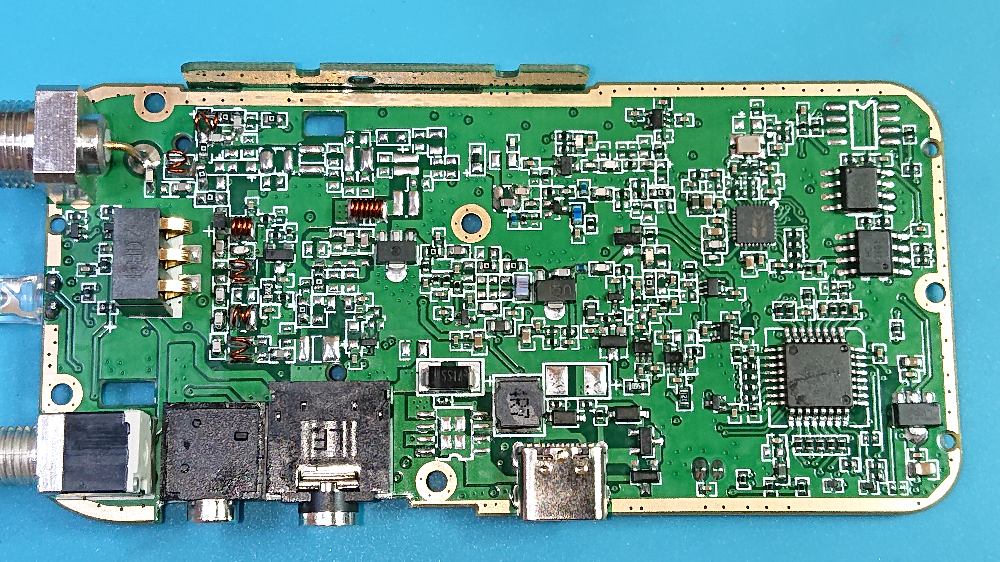
Download: https://disk.yandex.ru/i/xc0g9Or50LM3Hw

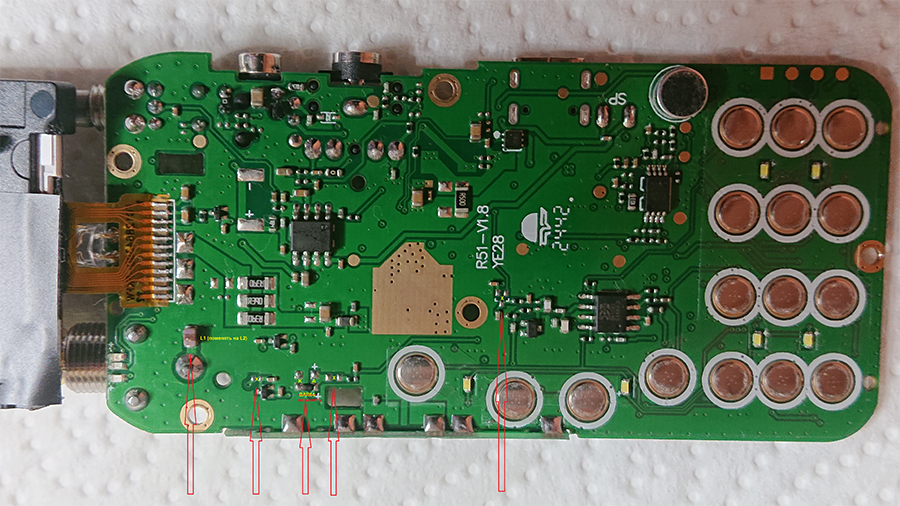
Download: https://disk.yandex.ru/i/fcQ9QfFDWocF1A

